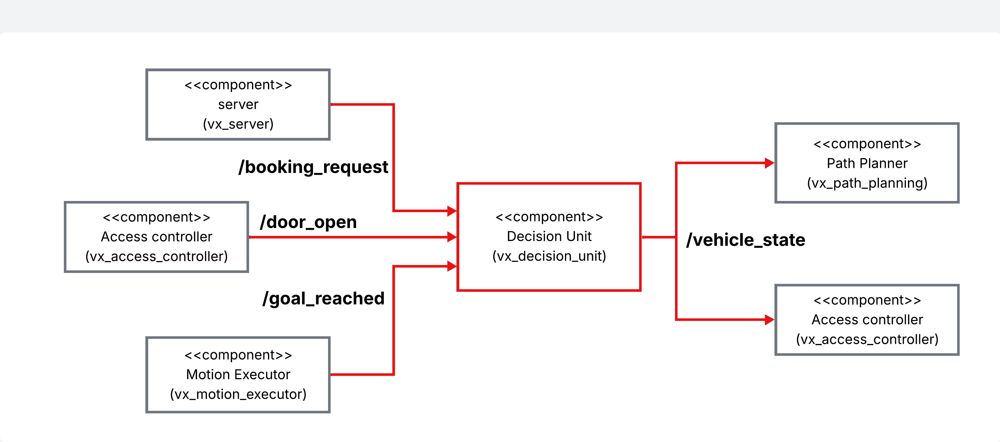

# Decision Unit

## Table of Contents
1. [Maintainer](#maintainer)
2. [Overview](#overview)
3. [Component Architecture](#component-architecture)
4. [ROS2 Topics](#ros2-topics)
5. [User Stories](#user-stories)
6. [Functionalities](#functionalities)
    - [Finite State Machine (FSM)](#finite-state-machine-fsm)
    - [Transition Logic](#transition-logic)
    - [Publisher and Subscriber Model](#publisher-and-subscriber-model)
7. [Dependencies](#dependencies)
8. [Installation and Setup](#installation-and-setup)
9. [Interface Test Procedure](#interface-test-procedure)
10. [Conclusion](#conclusion)

## Maintainer
- **Parth Pahinkar**

## Overview
The **Decision Unit** controls the shuttle's state machine by transitioning between various operational states based on inputs from external systems such as the booking request, goal locations, door status, and more. It ensures that the shuttle progresses through its journey in a systematic manner, from being idle to picking up passengers, dropping them off, and eventually parking. It leverages a finite state machine (FSM) for seamless transitions between these states.

## Component Architecture
  

## ROS2 Topics

| Type      | Topic Name       | Message Type    | Description |
|-----------|------------------|-----------------|-------------|
| **Input** | `/booking_request`  | `std_msgs/msg/Bool` | Signals that a booking request has been received. |
| **Input** | `/goal_reached`     | `std_msgs/msg/Bool` | Indicates whether a specific goal (pickup, dropoff, or parking) has been reached. |
| **Input** | `/door_open`        | `std_msgs/msg/Bool` | Indicates whether the shuttle doors are open or closed. |
| **Output** | `/vehicle_state`   | `std_msgs/msg/Int8` | Publishes the current state of the shuttle (e.g., Idle, Driving to Pickup, Boarding, etc.). |

## User Stories

### **US 1.1: Selection of State Machine Framework**
**As the developer, I want to select a state machine framework so that the shuttle's behavior logic can be organized into clearly defined states and transitions.**

**Acceptance Criteria:**
- **A.C.1.1.1**: Evaluate frameworks like transitions, Yasmin, or FlexBE for compatibility with ROS 2, ease of integration, and documentation.
- **A.C.1.1.2**: Framework must support clear and structured definition of shuttle states: Idle, Drive, Boarding, Deboarding, Parking.
- **A.C.1.1.3**: Framework must allow easy addition of new states.

### **US 1.2: Transition from Idle to Driving**
**As the Decision Unit, I want to transition the shuttle from Idle to Driving when booking information is received from the server module, so that the shuttle begins moving toward the pickup point.**

**Acceptance Criteria:**
- **A.C.1.2.1**: The Decision Unit shall subscribe to `/booking_request`.
- **A.C.1.2.2**: If `/vehicle_state = 0` (Idle) and `/booking_request = True`, publish `/vehicle_state = 1` (Driving to Pickup).

### **US 1.3: Transition from Driving to Boarding**
**As the Decision Unit, I want to transition from Driving to Boarding when the shuttle reaches the pickup location so that the passenger can board the shuttle.**

**Acceptance Criteria:**
- **A.C.1.3.1**: The Decision Unit shall subscribe to `/goal_reached`.
- **A.C.1.3.2**: If `/vehicle_state = 1` (Driving to Pickup) and `/goal_reached = True`, publish `/vehicle_state = 2` (Boarding).

### **US 1.4: Transition from Boarding to Driving**
**As the Decision Unit, I want to transition from Boarding to Driving when the doors are closed, so that the shuttle can depart toward the drop-off point.**

**Acceptance Criteria:**
- **A.C.1.4.1**: The Decision Unit shall subscribe to `/door_open`.
- **A.C.1.4.2**: If `/vehicle_state = 2` (Boarding) and `/door_open = False` (doors closed), publish `/vehicle_state = 3` (Driving to Drop-off).

### **US 1.5: Transition from Driving to Deboarding**
**As the Decision Unit, I want to transition from Driving to Deboarding when the shuttle reaches the drop-off location, so that passengers can exit.**

**Acceptance Criteria:**
- **A.C.1.5.1**: The Decision Unit shall subscribe to `/goal_reached`.
- **A.C.1.5.2**: If `/vehicle_state = 3` (Driving to Drop-off) and `/goal_reached = True`, publish `/vehicle_state = 4` (Deboarding).

### **US 1.6: Transition from Deboarding to Parking**
**As the Decision Unit, I want to transition from Deboarding to Parking when the passenger has exited and the doors are closed, so that the shuttle can move to its parking area.**

**Acceptance Criteria:**
- **A.C.1.6.1**: The Decision Unit shall subscribe to `/door_open`.
- **A.C.1.6.2**: If `/vehicle_state = 4` (Deboarding) and `/door_open = False` (doors closed), publish `/vehicle_state = 5` (Parking).

### **US 1.7: Transition from Parking to Idle**
**As the Decision Unit, I want to transition from Parking to Idle when the parking maneuver is complete, so that the shuttle can await the next booking.**

**Acceptance Criteria:**
- **A.C.1.7.1**: The Decision Unit shall subscribe to `/goal_reached`.
- **A.C.1.7.2**: If `/vehicle_state = 5` (Parking) and `/goal_reached = True`, publish `/vehicle_state = 0` (Idle).

## Functionalities

### Finite State Machine (FSM)
The **Decision Unit** is controlled by a **Finite State Machine (FSM)**, which manages the transitions between different operational states of the shuttle:
- **States**: Idle, Driving to Pickup, Boarding, Driving to Drop-off, Deboarding, Parking.
- **Transitions**: Each state transitions to another based on specific conditions such as `booking_request`, `goal_reached`, and `door_open`.

### Transition Logic
The FSM transitions between states when the specified conditions are met:
- Transition from **Idle** to **Driving to Pickup** occurs when a booking request is received (`/booking_request = True`).
- Transition from **Driving to Pickup** to **Boarding** occurs when the vehicle reaches the pickup location (`/goal_reached = True`).
- Transition from **Boarding** to **Driving to Drop-off** occurs when the doors are closed (`/door_open = False`).
- Transition from **Driving to Drop-off** to **Deboarding** occurs when the vehicle reaches the drop-off location (`/goal_reached = True`).
- Transition from **Deboarding** to **Parking** occurs when the doors are closed after deboarding (`/door_open = False`).
- Transition from **Parking** to **Idle** occurs when the parking goal is reached (`/goal_reached = True`).

### Publisher and Subscriber Model
The **Decision Unit** follows a **Publisher-Subscriber** model to communicate with other ROS 2 nodes:
- **Subscriptions**: The node subscribes to `/booking_request`, `/goal_reached`, and `/door_open`.
- **Publications**: It publishes the current vehicle state to `/vehicle_state`.

## Dependencies

1. **Server** – The system that sends booking requests to trigger transitions.
2. **Motion Executor** – To handle vehicle motion and publish goal reached signals.
3. **Access Controller** – To handle the door states and whether the shuttle doors are open or closed.
4. **Transitions Framework** – A Python library to manage the finite state machine (FSM) logic.

## Installation and Setup

Follow these steps to set up and run the **Decision Unit** node:

```bash
# Clone the repository
git clone https://git.hs-coburg.de/voyagex/vx_decision_unit.git
cd vx_decision_unit

# Clone other dependencies
# Make sure to clone and run the required dependencies:
# - server
# - motion_executor
# - access_controller

# Build the ROS 2 package
cd ~/decision_ws
colcon build --symlink-install

# Source the workspace
source install/setup.bash

# Run the Decision Unit node
ros2 run decision_unit decision_core_fsm

