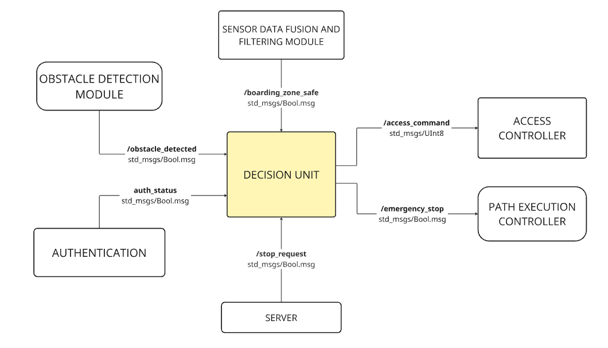

## 👥 Contributors

[Ravikumar Shivlal Savaliya](https://git.hs-coburg.de/ravisavaliya)  
[Parth Pahinkar](https://git.hs-coburg.de/par8824s)

---

## 📌 Table of Contents
- [📖 Overview](#-overview)
- [🏗️ Component Architecture](#-component-architecture)
- [🔌 ROS 2 Topics](#-ros-2-topics)
- [⚙️ Component Functionalities](#️-component-functionalities)
- [📥 Installation & Setup](#-installation--setup)
- [🧪 Interface Test Procedure](#-interface-test-procedure)

---

## 📖 Overview

The **Decision Unit Module** is responsible for high-level behavioral decision-making in the autonomous shuttle system. It interprets inputs such as boarding zone status, obstacle flags, authentication status, and remote stop requests, and translates them into actionable commands that affect path planning, execution, and access control.

It ensures the shuttle responds appropriately to dynamic environment changes and user interactions by publishing commands like vehicle state, emergency stop, and access authorization.

---

## 🏗️ Component Architecture

 


---

## 🔌 ROS 2 Topics

### Input Topics

| Topic Name                      | Message Type        | Description                                                                      |
|--------------------------------|---------------------|----------------------------------------------------------------------------------|
| `/fused_msgs/boarding_zone_safe` | `std_msgs/Bool`     | Whether the shuttle is in a safe boarding zone (from Sensor Fusion).            |
| `/obstacle_detected`            | `std_msgs/Bool`     | Obstacle presence flag from Obstacle Detection system.                          |
| `/auth_status`                  | `std_msgs/Bool`     | Indicates if the user is authenticated.                                         |
| `/stop_request`                 | `std_msgs/Bool`     | Emergency stop signal from the server/backend.                                  |

### Output Topics

| Topic Name         | Message Type        | Description                                                                      |
|--------------------|---------------------|----------------------------------------------------------------------------------|
| `/vehicle_state`   | `std_msgs/Bool`     | Drive/Stop signal for the Path Planning module.                                 |
| `/emergency_stop`  | `std_msgs/Bool`     | Immediate halt signal for Path Execution Controller.                            |
| `/access_command`  | `std_msgs/UInt8`    | Code sent to Access Controller to lock/unlock or control access.                |

---

## ⚙️ Component Functionalities

The Decision Unit evaluates multiple safety and authorization conditions before allowing the shuttle to proceed. It follows this logic:

- If an obstacle is detected (`/obstacle_detected = true`) or the server requests a halt (`/stop_request = true`), an emergency stop signal is issued.
- If the user is not authenticated or the shuttle is outside the boarding zone, no access command is granted and motion is disallowed.
- Only if all safety checks pass, a drive command (`/vehicle_state = true`) is issued and access is granted via `/access_command`.

This ensures that the shuttle operates only when it's safe and authorized to do so.

---

## 📥 Installation & Setup

### 🔧 Clone the Repository

```bash
git clone https://git.hs-coburg.de/voyagex/vx_decision_unit.git
```

### 🔨 Build the Package

```bash
cd vx_decision_unit
colcon build
source install/setup.bash
```

### 🚀 Run the Node

```bash
ros2 run decision_unit decision_node
```

---

## 🧪 Interface Test Procedure

This section explains how to test the Decision Unit's topic interfaces using dummy publishers in separate terminals.

---

### Step-by-Step Test

1. **Run the Decision Unit Node**
   ```bash
   ros2 run decision_unit decision_node
   ```

2. **Simulate Sensor Fusion Safe Zone**
   ```bash
   ros2 topic pub /fused_msgs/boarding_zone_safe std_msgs/Bool "data: true"
   ```

3. **Simulate Obstacle Detection**
   ```bash
   ros2 topic pub /obstacle_detected std_msgs/Bool "data: false"
   ```

4. **Simulate Authentication Status**
   ```bash
   ros2 topic pub /auth_status std_msgs/Bool "data: true"
   ```

5. **Simulate Stop Request from Server**
   ```bash
   ros2 topic pub /stop_request std_msgs/Bool "data: false"
   ```

6. **Verify Outputs**
   ```bash
   ros2 topic echo /vehicle_state
   ros2 topic echo /emergency_stop
   ros2 topic echo /access_command
   ```
