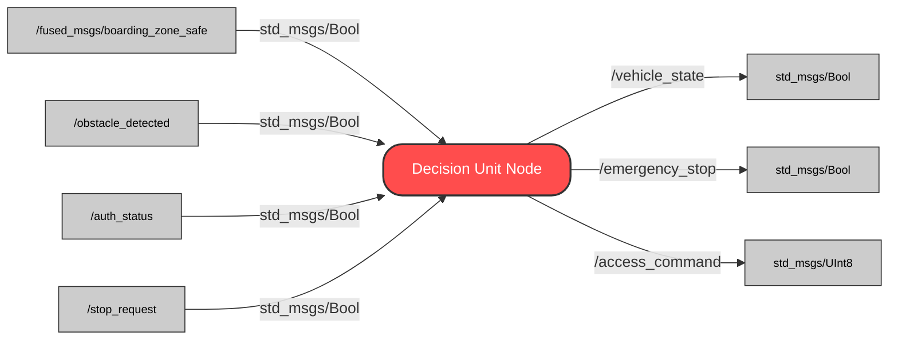

## Contents
- [Description](#description)
- [Architecture](#architecture)
- [Topics](#topics)
- [Contributor](#contributor)

---

## Description

The **Decision Unit Module** is responsible for high-level driving decisions based on inputs from the sensor fusion module, obstacle detection, system authentication, and server-issued stop requests. It ensures the shuttle navigates safely by publishing appropriate commands to motion and access controllers.

This node listens to the following input topics:

- `/fused_msgs/boarding_zone_safe`: Boolean message from the **Sensor Data Fusion and Filtering Module** indicating whether the shuttle is currently in a safe boarding zone.
- `/obstacle_detected`: A Boolean flag from the **Obstacle Detection system** indicating whether an obstacle is present in the path.
- `/auth_status`: A Boolean flag confirming whether the user is authenticated to access or board the shuttle.
- `/stop_request`: A Boolean signal from the backend **Server**, requesting the shuttle to stop immediately.

Based on these inputs, the node publishes:

- `/vehicle_state`: A drive or stop command for the **Path Planning** module.
- `/emergency_stop`: A high-priority stop signal for the **Path Execution** controller in unsafe conditions.
- `/access_command`: A code used by the **Access Controller** to unlock/lock doors or enable access.

---

## Architecture

---

## Topics

#### Input

| Name                          | Type                   | Description                                                                 |
|-------------------------------|------------------------|-----------------------------------------------------------------------------|
| `/fused_msgs/boarding_zone_safe` | `std_msgs/Bool.msg`     | Indicates whether the shuttle is in a safe boarding zone (from fusion module). |
| `/obstacle_detected`          | `std_msgs/Bool.msg`     | Obstacle presence flag from the obstacle detection unit.                    |
| `/auth_status`                | `std_msgs/Bool.msg`     | Boolean status indicating whether user is authorized to proceed.            |
| `/stop_request`               | `std_msgs/Bool.msg`     | A direct stop request signal from the server.                               |

#### Output

| Name                 | Type                 | Description                                                               |
|----------------------|----------------------|---------------------------------------------------------------------------|
| `/vehicle_state`     | `std_msgs/Bool.msg`   | Command to Path Planning module — drive (`true`) or stop (`false`).       |
| `/emergency_stop`    | `std_msgs/Bool.msg`   | Immediate halt signal to Path Execution Controller.                       |
| `/access_command`    | `std_msgs/UInt8.msg`  | Access control command for boarding system (e.g., lock/unlock).           |

---

## Contributor

[Ravikumar Savaliya](https://git.hs-coburg.de/ravisavaliya)  
[Parth Pahinkar](https://git.hs-coburg.de/par8824s)
